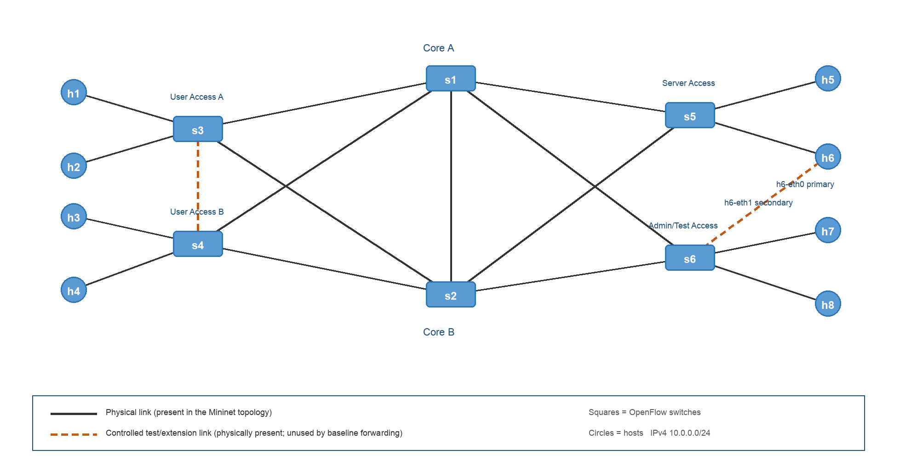
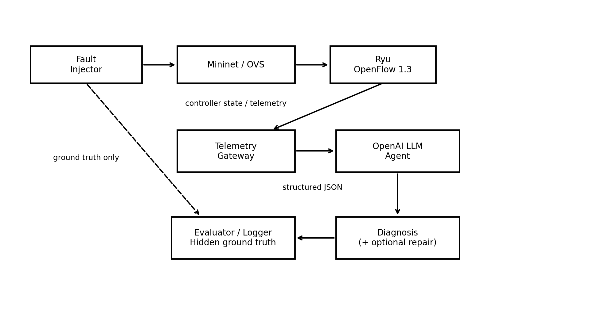
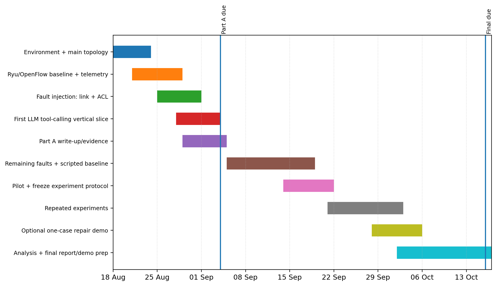

<!--
Converted from COMS6200_LLM_Network_Troubleshooting_PartA(5).docx on 19 Aug 2026.
This Markdown preserves the current 10-page report snapshot.
The three original embedded Word figures were extracted unchanged into ./assets/.
Do not convert planned work into completed claims without real evidence.
-->

# LLM-Based Network Troubleshooting Agent

**COMS6200 - Project Proposal / Progress Report (Part A)**

The University of Queensland

**<mark>[TEAM TO INSERT TEAM MEMBER 1 + STUDENT ID]</mark>**

**<mark>[TEAM TO INSERT TEAM MEMBER 2 + STUDENT ID]</mark>**

**<mark>[TEAM TO INSERT TEAM MEMBER 3 + STUDENT ID]</mark>**

**<mark>[TEAM TO INSERT TEAM MEMBER 4 + STUDENT ID]</mark>**

**Submission deadline: 4 September 2026, 3:00 pm**

Final project report deadline: 16 October 2026, 3:00 pm

# Abstract

This project investigates whether a tool-using large language model (LLM) can diagnose and localise common faults in an OpenFlow-controlled software-defined network more accurately or efficiently than a deterministic troubleshooting script. The testbed will use Mininet, Open vSwitch, OpenFlow 1.3 and a Python Ryu controller in a six-switch, eight-host Layer-2 topology with redundant paths. Five reproducible fault scenarios are proposed: link failure, congestion, ACL/policy error, forwarding loop, and a missing or incorrect OpenFlow rule. The LLM will not receive unrestricted shell access or hidden fault labels; instead, it will gather evidence through a small set of structured diagnostic functions for topology, ping, port state/statistics, flow tables and throughput. A deterministic baseline will use the same underlying information. Evaluation will focus on diagnosis accuracy, fault localisation, tool calls, diagnosis time and, for one controlled extension, repair success. The scope intentionally prioritises a complete, repeatable experimental pipeline over a large topology or broad fault catalogue. Current progress demonstrates Mininet custom-topology construction and controlled bandwidth, delay and packet-loss experiments; controller integration and the first end-to-end LLM episode remain priority tasks before Part A submission.

# 1. Introduction

Network troubleshooting is often an iterative process: an operator observes a symptom, selects a diagnostic test, interprets the result, narrows the candidate causes and repeats until a root cause can be localised. Software-Defined Networking (SDN) makes this process especially suitable for automation because the control plane can maintain a logically centralised view of topology and forwarding state while OpenFlow exposes programmable match-action rules and counters. This project focuses on an LLM-based troubleshooting agent that can use topology information, ping, traceroute, flow tables and link statistics to diagnose faults such as congestion, link failures, ACL errors and forwarding loops.

Large language models add a different capability from conventional rule-based monitoring: they can choose diagnostic actions adaptively, interpret heterogeneous evidence and produce natural-language explanations. However, a useful university project should not assume that this flexibility automatically produces correct diagnoses. Recent network-agent research reports that larger LLM-based agents succeed more often in detecting network issues but still struggle to localise faults and identify root causes [@wang2025_nika], while work on symptom-aware, phase-gated diagnostic escalation shows that structuring evidence acquisition and hypothesis commitment can improve root-cause identification [@tseng2026_sade]. This motivates an empirical comparison rather than a demonstration-only system.

The primary research question is therefore: **How accurately and efficiently can a tool-using LLM agent diagnose and localise common faults in an OpenFlow-controlled Mininet network compared with a deterministic scripted troubleshooting baseline?** A secondary question will be retained only as a controlled extension: **Can a diagnosed link failure be safely resolved through a constrained OpenFlow rerouting action and validated without creating unintended connectivity changes?**

The project is intentionally scoped around one representative topology, five fault scenarios, a bounded diagnostic tool set and a paired evaluation against one credible deterministic baseline. This is consistent with course-coordinator guidance received by the team: there is no fixed topology size or fault count; the network should start minimal and scale only as required by the scenarios; automatic repair is optional; and API usage should be instrumented and capped. The expected contribution is not a claim of a novel general-purpose network copilot. Instead, the project will provide a controlled and reproducible SDN testbed in which an LLM and a scripted method diagnose the same hidden faults from the same observable evidence.

# 2. Background

## 2.1 Software-Defined Networking and OpenFlow

SDN separates network-control logic from packet forwarding. In the classic architecture, a logically centralised controller maintains network state and programs data-plane switches through a southbound interface. OpenFlow was proposed around a standardised interface that allows a controller to add and remove entries in a switch's flow table [@mckeown2008_openflow]. This separation is central to the proposed project: faults can exist in the physical/link state, in controller knowledge, or in the forwarding policy installed in Open vSwitch, and the troubleshooting agent must use evidence across these layers rather than treat every failure as a simple connectivity problem.

An OpenFlow flow entry implements a match-action abstraction. Packets can be matched on fields such as ingress port, MAC address, EtherType, IP addresses and transport ports, then forwarded to one or more output ports, sent to the controller or dropped. OpenFlow also maintains per-flow and per-port counters. OpenFlow's match-and-action primitives, including selective forwarding and dropping, provide mechanisms that this project can use to construct controlled ACL errors, blackholes and forwarding-loop scenarios [@mckeown2008_openflow; @onf2015_openflow13]. OpenFlow 1.3 will be used because it provides the flow-programming, controller-messaging and statistics functionality required by the proposed experiments [@onf2015_openflow13], is supported by Open vSwitch [@ovs2026_openflow_docs], and aligns with COMS6200 course material. Features introduced in later OpenFlow versions are not required for the project's fault scenarios or evaluation.

Relevant controller messages include Packet_In, Packet_Out and Flow_Mod. A table miss can cause a switch to encapsulate a packet in Packet_In for the controller; the controller can issue Packet_Out for an individual packet or Flow_Mod to install persistent forwarding behaviour. Flow and PORT_STATS requests provide counters that can be used for traffic and fault diagnosis. The project will use these concepts directly: the controller will install loop-free normal forwarding, the telemetry layer will query state and counters, and fault injectors will create specific incorrect rules or link conditions.

## 2.2 Mininet, Open vSwitch and topology knowledge

Mininet provides a practical experimental platform by using lightweight OS-level virtualisation to create virtual hosts, switches, controllers and links on a single machine while allowing real network software to run in the emulated environment [@lantz2010_mininet]. Custom Python topologies and traffic-control links allow experiments to be automatically recreated. Open vSwitch (OVS) will provide the software data plane controlled through OpenFlow [@ovs2026_openflow_docs]. The experiment harness will force OpenFlow 1.3 and avoid uncontrolled bridge fallback in the redundant topology, because cyclic Layer-2 connectivity must be governed by explicit loop-free forwarding rules.

A controller must know the network topology before it can reason about expected paths. Pakzad et al. describe topology discovery as a critical controller service and detail the de facto LLDP-based approach in which controllers send LLDP packets through OpenFlow Packet_Out messages and receive them through Packet_In messages to infer inter-switch links [@pakzad2016_topology]. They evaluate topology discovery across multiple network topologies using the Mininet network emulator and additionally validate their results on the OFELIA SDN testbed [@pakzad2016_topology]. This project does not propose a new discovery protocol; it will consume the controller topology view as diagnostic evidence.

## 2.3 Network telemetry and LLM tool use

The troubleshooting system will combine active tests with controller state. Active tests such as ICMP ping reveal reachability, loss and round-trip delay; short iperf tests provide a direct throughput signal. Controller and OVS state provide port/link status, flow tables and counters. For a Layer-2 fabric, ordinary IP traceroute is not expected to reveal each internal OpenFlow switch because the switches are not IP router hops. The project will therefore not redesign the network as Layer 3 simply to make traceroute useful. Instead, the equivalent path evidence will be derived from discovered topology, expected path computation, flow-table output actions and port statistics.

The LLM will interact with this evidence through structured function calls rather than an unrestricted terminal. The general design follows the tool-using agent pattern exemplified by ReAct, in which a language model interleaves reasoning traces with task-specific actions and observations from an external environment [@yao2023_react]. OpenAI documents GPT-5 mini as supporting function calling and structured outputs and lists the version-pinned snapshot gpt-5-mini-2025-08-07 [@openai2026_gpt5mini]. Given the bounded experiment size, GPT-5 mini is proposed as the single primary model; token usage and API cost will be logged for each episode. Model benchmarking is deliberately out of scope because COMS6200 has a separate project idea devoted to comparing language models.

# 3. Related Work

Foundational SDN work established the programmable-control model used in this project. McKeown et al. proposed OpenFlow as a standardised interface to switch flow tables [@mckeown2008_openflow], while Lantz, Heller and McKeown showed that Mininet could rapidly prototype software-defined networks on a single machine [@lantz2010_mininet]. Pakzad et al. evaluated the control overhead of the de facto OpenFlow topology-discovery approach and proposed modifications that reduce controller and control-traffic overhead while preserving discovery functionality [@pakzad2016_topology]. These works provide the network-control foundation, but they do not evaluate LLM-based diagnostic decision making.

More recent LLM-agent literature is directly relevant to the diagnostic architecture. ReAct introduced a framework that interleaves language-model reasoning with task-specific actions and external observations [@yao2023_react]. NIKA provides a public benchmark for LLM-driven network incident diagnosis and troubleshooting, and its evaluation shows that LLM agents still struggle with fault localisation and root-cause identification [@wang2025_nika]. SADE introduces a symptom-aware, phase-gated diagnostic workflow and reports substantially improved root-cause performance compared with a ReAct-based baseline [@tseng2026_sade]. Nissist uses LLMs to extract knowledge from unstructured troubleshooting guides and historical incident-mitigation information to support incident mitigation [@an2024_nissist]. NIKA, SADE and Nissist are useful context but are not identical to the proposed experiment: this project focuses on a small, fully controlled OpenFlow testbed in which the injected fault, topology, diagnostics and scoring are known and reproducible.

Industry products also demonstrate practical interest in AI-assisted network operations. Cisco product documentation describes AgenticOps capabilities in which the Cisco AI Assistant can diagnose root causes and execute automated, deterministic fixes for network issues [@cisco2026_agenticops]. Juniper product documentation describes Marvis as an AI-driven, interactive virtual network assistant with real-time network visibility that can identify issues, recommend corrective actions and, in self-driving mode, automatically fix selected issues [@juniper2026_marvis]. These products establish industry relevance, but their internal data, policies and evaluation procedures are proprietary. The proposed COMS6200 testbed therefore complements commercial systems by enabling transparent ground truth, reproducible fault injection and a fair comparison with a deterministic baseline.

The project will avoid overclaiming novelty. Its academically defensible contribution is a small experimental framework that evaluates tool selection, diagnosis and localisation under controlled SDN faults, with the same observable data available to the LLM and the scripted baseline. This directly addresses the course project question while remaining feasible within the remaining semester.

# 4. Project Aim and Scope

## 4.1 Aim and objectives

The project aim is to implement and evaluate a bounded LLM troubleshooting agent for an OpenFlow-controlled Mininet network. The system must diagnose what failed, localise where the fault resides, cite the evidence it used, and be compared with a deterministic troubleshooting procedure. The implementation will emphasise experimental control and reproducibility rather than topology size.

- Implement one six-switch/eight-host redundant Layer-2 Mininet topology controlled through OpenFlow 1.3.

- Create five automated, resettable fault scenarios covering the four official categories plus one low-cost forwarding-rule fault.

- Expose a small set of structured, read-only diagnostic tools to one OpenAI model.

- Implement one deterministic troubleshooting baseline using the same underlying information.

- Run paired repeated trials and measure diagnosis accuracy, localisation, diagnostic effort and time.

- If the core diagnosis experiment is complete, demonstrate one allow-listed automatic reroute for a link failure and validate the result.

## 4.2 In scope and out of scope

In scope are fault classification, precise localisation, root-cause explanation, bounded tool selection, repair recommendation and optional single-case repair. The primary network will remain Layer 2. Fault injection will cover link state, traffic contention, policy/ACL state and OpenFlow forwarding state. The agent will operate only through predefined functions and will not receive the fault label or injector configuration.

Out of scope are multi-topology scaling experiments, compound faults, controller-failure benchmarking, duplicate-IP or host-addressing faults, asymmetric routing, full Layer-3 routing, a large model-comparison study and broad autonomous remediation. These are reasonable future extensions but would dilute the core experiment under the 16 October deadline. Ryu will remain the preferred controller if it is stable in the course environment. Its upstream repository states that Ryu is not currently maintained and points users to OpenStack's os-ken as a maintained Ryu alternative [@ryu2026_framework]. If a fallback becomes necessary, its compatibility with the project's standalone OpenFlow workflow will be verified before adoption; implementing multiple controllers in parallel remains out of scope.

# 5. Methodology

## 5.1 Experimental topology and SDN environment

The primary testbed will contain six OpenFlow switches and eight hosts. Switches s1 and s2 form redundant cores. Access switches s3-s6 each connect to both cores and each attach two hosts. The s1-s2 inter-core link is retained as an alternate/experimental path but does not need to carry normal traffic. This design is smaller than a Clos or fat-tree but still supports redundancy, alternate paths, cycles and multiple fault locations. It is therefore complex enough for the official fault categories while keeping flow tables and diagnosis traces interpretable.

Figure 1. Proposed six-switch/eight-host dual-core Mininet topology.

All hosts will initially share a single IPv4 subnet to minimise routing implementation overhead. Normal unicast forwarding will be installed explicitly by the controller; ARP/broadcast handling will use a controller-defined loop-free strategy. The topology will be implemented in Python using Mininet and TCLink so that bandwidth and delay can be controlled where required. OVS bridges will be configured for OpenFlow 1.3 and a secure controller fail mode. Ryu will supply topology and OpenFlow state; version and dependency information will be recorded in the experiment log.

## 5.2 Agent architecture and diagnostic tools

The architecture separates fault injection, network execution, telemetry, diagnosis and evaluation. The injector owns the hidden ground truth; the LLM and baseline receive only an external symptom and data returned by allowed tools. This prevents direct leakage such as showing the LLM a tc configuration that literally states "loss 10%". The evaluator records both the ground truth and the diagnostic trajectory after each run.

Figure 2. Proposed troubleshooting architecture. Ground truth is isolated from the diagnostic agent.

The primary LLM will use the OpenAI API with structured function calling. The version-pinned GPT-5 mini snapshot gpt-5-mini-2025-08-07 is proposed because the official model documentation lists support for function calling and structured outputs and explains that snapshots lock a specific model version for consistent behaviour [@openai2026_gpt5mini]. Each episode will log the exact model identifier, prompt/version, token usage, tool calls and wall-clock time. API budgets and per-episode limits will be enforced to prevent runaway token use.

| **Tool**            | **Purpose**                                                 | **Compact return**                            |
|---------------------|-------------------------------------------------------------|-----------------------------------------------|
| get_topology()      | Controller view of switches, links and host attachments     | Nodes, links, port IDs and status             |
| ping(src,dst)       | Reachability, packet loss and RTT                           | sent/received, loss %, min/avg/max RTT        |
| get_port_status(sw) | Administrative/operational port state                       | port, peer, up/down                           |
| get_port_stats(sw)  | Traffic counters and derived link rates                     | packet/byte deltas, drops/errors, utilisation |
| get_flow_table(sw)  | Inspect OpenFlow matches, priorities, actions and counters  | normalised flow entries                       |
| iperf(src,dst)      | Short TCP throughput test for congestion/performance faults | duration, transfer, Mbit/s                    |

Table 1. Controlled diagnostic functions exposed to the LLM and scripted baseline.

Traceroute is not included as a core tool because the testbed is an L2 OpenFlow fabric; ordinary IP traceroute would typically show only the endpoint path at Layer 3 and not reveal each internal switch. If retained for completeness, it will be documented as secondary evidence only. The more relevant SDN path evidence is the combination of topology, expected forwarding graph, flow output actions and counter activity.

## 5.3 Fault scenarios and injection

Five scenarios will be implemented. Each scenario will be declared in a small configuration file and injected by Python so it can be repeated and reset from a known baseline. The project will not implement dozens of variants. Instead, every scenario will have one clearly defined expected root cause and a measurable symptom, and the same scenario definition can be repeated with controlled seeds or traffic timing where relevant.

| **Scenario**              | **Injected fault**                                    | **Mechanism**                                | **Expected diagnostic evidence**                            | **Correct outcome**                                                 |
|---------------------------|-------------------------------------------------------|----------------------------------------------|-------------------------------------------------------------|---------------------------------------------------------------------|
| F1 Link failure           | Disable one primary access-to-core link (e.g., s3-s1) | Mininet link status / port down              | Path failure or fallback path; link state confirms location | Locate failed link; recommend alternate path; optional reroute demo |
| F2 Congestion             | Competing flows share a constrained core uplink       | TCLink capacity + background iperf traffic   | Ports remain UP; high utilisation; throughput/RTT degrade   | Identify congested link and competing load                          |
| F3 ACL/policy error       | High-priority drop rule blocks one source/service     | OpenFlow Flow_Mod or Ryu REST flow rule      | Selective protocol/source failure; healthy links            | Locate conflicting drop rule and correct/delete it                  |
| F4 Forwarding loop        | Narrow test flow is sent around a short cycle         | High-priority output rules with hard timeout | No delivery; abnormal counter growth on cycle               | Identify cyclic rules and remove offending entry                    |
| F5 Missing/incorrect flow | Delete required flow or send to wrong egress          | Flow delete/override                         | Topology healthy but target flow blackholes/misroutes       | Locate missing/wrong rule and restore expected action               |

Table 2. Core fault scenarios. The first four correspond directly to the official project categories.

Forwarding-loop injection will be safety constrained. Only a narrowly matched test flow will be affected, rules will use a short hard timeout, traffic will be low rate, and a watchdog will remove fault-cookie rules if the scenario does not terminate as expected. This avoids destabilising the whole Layer-2 fabric. For congestion, the experiment will distinguish a true load-induced condition from a static low-bandwidth link: the correct diagnosis should rely on simultaneous utilisation/counter evidence and competing traffic rather than merely noticing a configured bandwidth value.

## 5.4 Deterministic scripted baseline

The baseline will be a credible deterministic troubleshooter rather than a deliberately weak comparator. It will use the same telemetry gateway and the same episode budget. A simple decision procedure is sufficient: first test endpoint reachability; then inspect relevant port/link state; if the path remains physically healthy, collect short performance/counter measurements; then inspect flow-table state for drops, priority conflicts, missing rules, wrong outputs or cycles. The baseline will return the same structured diagnosis fields as the LLM. Thresholds for congestion or abnormal loss will be calibrated on healthy pilot runs and frozen before the final experiment.

Fairness requires that neither method receives hidden ground truth and that both operate on a clean topology with equivalent diagnostic information. The LLM may choose tools adaptively; the scripted baseline follows its fixed procedure. This difference is the intended experimental variable.

## 5.5 Ground truth, experiment size and evaluation

Every fault injector will record an evaluator-only ground-truth object containing fault family, location, affected traffic and expected corrective action. This object will never be passed into the LLM prompt or baseline. Before each episode the topology will be reset or rebuilt, normal connectivity will be verified, and the fault will then be injected. After the diagnostic run, the evaluator will compare the predicted family and location against the hidden record.

The proposed final experiment contains five scenarios with **eight repetitions per scenario**, giving 40 fault instances for each method. Each instance will be run once with the LLM and once with the scripted baseline from a fresh network state, for approximately 80 diagnostic runs in total. Eight repetitions are sufficient to reveal obvious instability in the LLM without consuming the semester on a large benchmark. For stochastic congestion or packet timing, scenario seeds and realised measurements will be logged. If pilot results show extremely low variance, the team may keep eight repetitions; if variance is high and time permits, the upper limit will be ten.

| **Metric**            | **Definition**                                                              | **Role**                                             |
|-----------------------|-----------------------------------------------------------------------------|------------------------------------------------------|
| Diagnosis accuracy    | Percentage of episodes with the correct fault family                        | Primary effectiveness metric                         |
| Localisation accuracy | Correct switch/link/flow-rule location                                      | Separates generic recognition from precise diagnosis |
| Tool calls            | Number of diagnostic function calls before final answer                     | Diagnostic efficiency                                |
| Diagnosis time        | Wall-clock time from symptom to final diagnosis                             | Operational efficiency                               |
| Repair success        | For optional F1 repair only: connectivity restored and invariants preserved | Controlled extension                                 |
| Token usage / cost    | Input/output tokens and estimated API cost                                  | Operational record; secondary metric                 |
| Valid tool-call rate  | Malformed/invalid calls divided by attempted calls                          | Reliability check                                    |

Table 3. Evaluation metrics retained for the final experiment.

Results will be reported as raw counts, percentages and simple descriptive statistics. Accuracy will be broken down by fault scenario. Tool calls and diagnosis time will be summarised with median and range (or interquartile range if appropriate), because API/network timings can be skewed. Confidence intervals may be reported for diagnosis accuracy where useful. Sophisticated statistical testing is not required unless the completed dataset justifies it; a clear paired comparison and transparent raw results are more important than adding unnecessary analysis.

# 6. Project Plan

The schedule is constrained by the Part A deadline of 4 September 2026 and the final report deadline of 16 October 2026. The first objective is a working vertical slice before Part A: main topology, Ryu/OpenFlow connectivity, structured telemetry, one automated fault and one LLM tool-calling diagnosis. The remaining scenarios, baseline and repeated experiments follow after Part A. This ordering prioritises the 30% "Progress So Far" component of the Part A rubric and reduces the risk of discovering integration problems late in the semester.

Figure 3. Calendar-based implementation and evaluation plan, 18 August-16 October 2026.

| **Dates**    | **Milestone / deliverable**                                                               |
|--------------|-------------------------------------------------------------------------------------------|
| 18-23 Aug    | Freeze environment; implement final six-switch/eight-host topology; baseline connectivity |
| 21-28 Aug    | Connect OVS to Ryu; OpenFlow 1.3; expose topology, flows and port statistics              |
| 25-31 Aug    | Automate link-failure and ACL/missing-flow injectors; implement reset checks              |
| 28 Aug-3 Sep | OpenAI function-calling integration; first structured LLM diagnosis; token logging        |
| 29 Aug-4 Sep | Collect Part A evidence, refine proposal, submit Part A by 3:00 pm                        |
| 5-18 Sep     | Implement congestion and safe loop scenarios; complete deterministic baseline             |
| 14-21 Sep    | Pilot all faults; calibrate thresholds; freeze scenario definitions and scoring           |
| 21 Sep-2 Oct | Run paired repeated trials; inspect failed/malformed episodes                             |
| 28 Sep-5 Oct | Optional one-case link-failure reroute/validation if core experiment is complete          |
| 2-16 Oct     | Analysis, figures, final report, demonstration and Q&A preparation                        |

Table 4. Key milestones and deliverables.

# 7. Progress So Far

The team has completed practical Mininet work that directly supports the proposed methodology. This progress is genuine and demonstrates that custom topology construction and traffic-control effects can be reproduced in the current environment. However, the work completed to date has primarily used Mininet with OVS bridge fallback rather than the final Ryu/OpenFlow controller architecture. The report therefore distinguishes confirmed results from tasks that still require evidence before submission.

| **Work item**                           | **Status**        | **Evidence**                                                                                                                                                                  |
|-----------------------------------------|-------------------|-------------------------------------------------------------------------------------------------------------------------------------------------------------------------------|
| Mininet parameterised topologies        | Completed         | Linear and tree topologies created; host/switch interfaces inspected with net.                                                                                                |
| Custom Python topology                  | Completed         | Repository topology progress5s2h reproduced the five-switch/two-host layout; nodes, net and links confirmed all seven nodes and six intended links, with all links reporting OK. |
| Connectivity validation                 | Completed         | Fresh h1-h2 test: 10/10 ping replies, 0% loss; RTT min/avg/max 0.103/0.193/0.873 ms.                                                                                          |
| Bandwidth control                       | Completed         | Fresh progressbw10 test: a 10 Mbit/s TCLink delivered 9.38 Mbit/s receiver throughput over a 5 s iperf3 run. An impaired 1 Mbit/s variant later delivered 832 Kbit/s under added delay/loss. |
| Delay control                           | Completed         | Fresh progressimpaired test: 5 ms configured delay per direction produced 10.171 ms average RTT over a 100-packet h1-h2 ping (min/max 10.115/10.690 ms). |
| Packet-loss control                     | Completed         | Fresh progressimpaired test: 10% loss configured on each direction of the affected TCLink produced 81/100 ping replies (19% round-trip loss), consistent with the bidirectional impairment. |
| Ryu + OpenFlow 1.3 main topology        | Not yet evidenced | \[TEAM TO INSERT ACTUAL RESULT/SCREENSHOT HERE BEFORE SUBMISSION\]                                                                                                            |
| Structured topology/flow/port telemetry | Not yet evidenced | \[TEAM TO INSERT ACTUAL JSON/SCREENSHOT HERE BEFORE SUBMISSION\]                                                                                                              |
| Automated project fault injector        | Not yet evidenced | \[TEAM TO INSERT FIRST LINK-FAILURE OR ACL INJECTOR RESULT HERE\]                                                                                                             |
| OpenAI function-calling diagnosis       | Not yet evidenced | \[TEAM TO INSERT FIRST TOOL-CALL TRACE AND TOKEN USAGE HERE\]                                                                                                                 |

Table 5. Confirmed progress and evidence gaps as of 20 August 2026.

The 100-packet impaired-link run observed 19% end-to-end ICMP loss, consistent with independent 10% loss affecting both request and reply directions, while the same configuration reduced TCP receiver throughput to 832 Kbit/s with 77 retransmissions.

The performance measurements above are not final project results and should not be presented as evidence that the LLM agent already works. Their value is methodological: they confirm that the team can create topologies, inspect interfaces, measure throughput/latency and apply controlled TCLink impairments, which are required for the planned congestion and link-quality experiments. The most valuable remaining evidence for Part A is an end-to-end controller-based vertical slice.

**<mark>[TEAM TO INSERT ONE CLEAR SCREENSHOT OF THE FINAL 6-SWITCH/8-HOST TOPOLOGY RUNNING UNDER RYU/OPENFLOW 1.3 HERE]</mark>**

**<mark>[TEAM TO INSERT ONE SHORT EXAMPLE OF STRUCTURED TELEMETRY AND, IF AVAILABLE, THE FIRST LLM TOOL-CALL DIAGNOSIS HERE]</mark>**

# 8. Risks and Mitigation

| **Risk**                          | **Consequence**                                                                            | **Mitigation**                                                                                                                          |
|-----------------------------------|--------------------------------------------------------------------------------------------|-----------------------------------------------------------------------------------------------------------------------------------------|
| Ryu/Python compatibility          | Controller integration may fail or delay progress because upstream Ryu is not currently maintained [@ryu2026_framework]. | Freeze and pin a known-good Ryu environment. If Ryu cannot be made stable, evaluate os-ken as a fallback after compatibility testing rather than implementing both controllers in parallel.             |
| OpenFlow / L2 loop safety         | A deliberately injected loop can create a packet storm.                                    | Match only one test flow, short hard_timeout, low-rate probe, watchdog cleanup and full network reset.                                  |
| LLM invalid or excessive tool use | Malformed calls, repeated diagnostics or token growth.                                     | Strict schemas/enums, 8-10 call cap, output normalisation, per-episode token/time limits.                                               |
| Insufficient implementation time  | Too many fault variants reduce quality or prevent evaluation.                              | Keep one topology, five scenarios and one model. Cut optional repair before cutting diagnosis/evaluation.                               |
| Experimental contamination        | Residual flows, tc settings, traffic processes or ARP state alter later trials.            | Automated clean-state checks; restart/rebuild topology between final episodes where practical.                                          |
| API variability/cost              | Non-deterministic answers or unexpected usage.                                             | Use a version-pinned model snapshot, log tokens, run 8 paired repetitions, set hard usage limits and keep prompts/tool outputs concise. |

Table 6. Principal project risks and mitigations.

# 9. Conclusion

The proposed project is a deliberately constrained but technically substantive evaluation of LLM-assisted SDN troubleshooting. A six-switch/eight-host dual-core Mininet topology supplies redundant paths and enough forwarding complexity to reproduce the four official fault categories, while a fifth missing/incorrect-flow scenario adds useful OpenFlow-specific coverage with little extra implementation cost. The LLM will gather evidence through a small, auditable tool set and will be compared fairly with a deterministic baseline using hidden ground truth and repeated paired trials.

This scope is achievable by 16 October because it avoids unnecessary Layer-3 routing, topology scaling, compound faults and broad autonomous remediation. The immediate priority before Part A is not additional literature or topology complexity, but a working Ryu/OpenFlow vertical slice with structured telemetry, one automated fault and one LLM tool-call episode. If that foundation is demonstrated and the final five scenarios are executed reproducibly, the project will provide clear evidence of technical understanding, initiative, measurable methodology and genuine implementation progress aligned with the COMS6200 marking criteria.

# References

<!-- Generated automatically from references.bib -->

**Team review note:** Before submission, replace all highlighted TEAM TO INSERT placeholders, verify the exact Ryu/OVS/Python versions used, and update any progress statements with screenshots/logs from the final controller-based implementation. Do not convert planned work into past-tense claims until it has been demonstrated.
